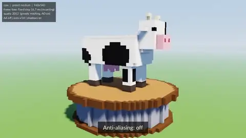
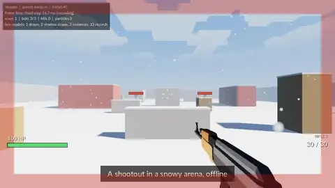
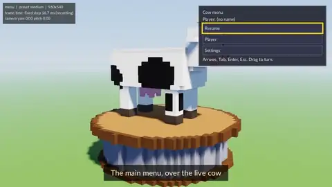

# swindowzig

A Zig game engine for the browser (WebGPU, wasm) and the desktop. One codebase.

<!-- progress:start -->


**Engine: 100.0% complete** `████████████████████` (43 of 43 issues)

| State | Issues |
|---|---|
| done | 43 |
| in-review | 0 |
| in-progress | 0 |
| ready | 0 |
| backlog | 0 |

A GitHub workflow writes this block from the
[`engine` issues](https://github.com/seanmizen/swindowzig/issues?q=label%3Aengine).
Do not edit it. `scripts/progress.mjs` gives the rules.
<!-- progress:end -->

|  |  |  |
|---|---|---|
| Cow: settings change as it turns | Shooter: a snowy shootout | Menu: settings, rebinding, RTL text |

## Try it

```bash
zig build run -Ddemo=shooter      # desktop
yarn dev:demo shooter             # browser
```

## Use it

```bash
zig fetch --save https://github.com/seanmizen/swindowzig/releases/download/v0.3.0/swindowzig.tar.gz
```

```zig
const sw = b.dependency("swindowzig", .{ .platform = .native });
exe.root_module.addImport("sw_app", sw.module("sw_app"));
```

## What is inside

| Library | What it does |
|---|---|
| `sw_core` | Fixed timestep, events, input, record and replay |
| `sw_platform` | The window: SDL2 on the desktop, a canvas on the web |
| `sw_app` | `run()` and the context of each callback |
| `sw_gpu` | The WebGPU API on wgpu-native and on the browser |
| `sw_math` | Vectors, matrices, quaternions, boxes, rays, the camera |
| `sw_gfx2d` | 2D rectangles, outlines and textured quads in batches |
| `sw_text` | TTF and bitmap fonts, bidi text, measure, wrap, draw |
| `sw_ui` | Layout, focus, widgets, screens, a semantic tree for screen readers |
| `sw_render` | Frame graph, post effects, sky, shadows, lights, weather, particles |
| `sw_audio` | WAV and Ogg Vorbis, a mixer, 3D sound, streams |
| `sw_assets` | File loads, PNG, zip, player files, a cache |
| `sw_net` | A WebSocket client on the web and the desktop |
| `sw_jobs` | Worker pools: threads on the desktop, Web Workers on the web |
| `sw_voxel` | Voxel chunks: light, meshes, a chunk pipeline, LOD, culling, collision |

## Make the videos

```bash
yarn demos:record   # every demo × every preset, from TAS scripts
```

MIT. Third-party credits: [THIRD_PARTY_NOTICES.md](THIRD_PARTY_NOTICES.md).
More: [docs/overview.md](docs/overview.md), [demos/README.md](demos/README.md).
