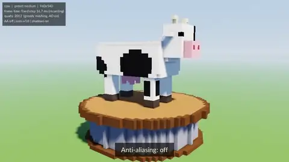
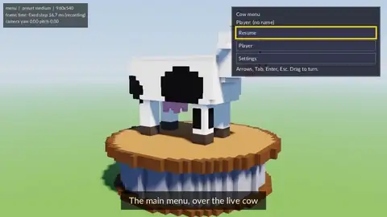
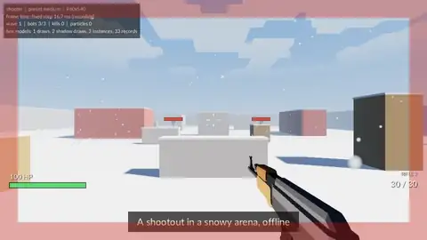

# Demos

Showcase demos of swindowzig. `examples/` keeps the small API examples.
Each demo here plays a script on the fixed timestep, so a video of it is the
same on each run.







| Demo | What it shows |
|---|---|
| `cow` | An original voxel cow turns on a stand. The script changes one setting at a time. Anti-aliasing: off, FXAA, MSAA. Meshing: naive, greedy, with a wireframe and the quad count. Colour: the tonemap curve, the exposure, a palette swap. Light: the time of day, shadows, ambient occlusion. Then fog and the sky. |
| `shooter` | A first-person fight in a snowy arena, offline. Three bots move, take cover, step out and fire back. Falling snow, a cloud layer, fog, the sky and shadows. Muzzle flashes, impacts and snow as particles. The bots are one box model, a dead bot falls as a ragdoll, and the shots play as 3D sound. The script plays the player with key and mouse commands; the bots use a seeded random number generator, so each run gives the same fight. Escape or the gamepad Start button pauses the fight: the pause menu changes the graphics (preset, shadows, shadow quality, anti-aliasing, vsync, frame limit), the mouse and the volume at once, and saves them. A second map, `indoor` (`--map indoor`, or Map in the pause menu), is a closed room with no sun and no bots. Two point lights with cube shadow maps light it. A warm lamp hangs still at the centre. A cool lamp moves on a rail near the ceiling. L or the gamepad north button sends the rail lamp to the other end. A shot on the button on the wall does the same, with a click. Each crate casts two shadows. The Room light slider in the pause menu sets the ambient light of the room. The gun models are the Quaternius Ultimate Gun Pack (CC0). |
| `menu` | A full game menu over the turning cow (sw_ui). A main screen and a screen stack with Back. The focus moves with the keyboard, the mouse and a gamepad. Graphics, audio, controls (key rebinding with a conflict warning, mouse sensitivity, invert Y) and gamepad (dead zone) settings apply at once to the cow. A text field, the on-screen keyboard, a scroll list and tooltips. English or Hebrew (right to left), and a TrueType or a bitmap font. The web page mirrors the menu for a screen reader. |

## Commands

```bash
zig build run -Ddemo=cow                      # a window; the script plays in a loop
zig build run -Ddemo=cow -- --preset high     # low | medium (default) | high
zig build native -Ddemo=cow                   # build zig-out/bin/cow
./zig-out/bin/cow --tas my.tas                # play another script
./zig-out/bin/cow --capture out/cow           # no window: each frame to out/cow/frames.bgra
./zig-out/bin/cow --check                     # no window: compare the checkpoint hashes
./zig-out/bin/cow --check --update            # write demos/cow/hashes/lavapipe-medium.txt
yarn dev:demo cow                             # the web build in a browser (port 3020)
yarn demos:record                             # an MP4 and a WebP for each demo and preset
yarn demos:check                              # the hash check of each demo and preset
./zig-out/bin/shooter --list-maps             # the maps of a demo: arena, indoor
./zig-out/bin/shooter --map indoor --check    # the script and the hashes of one map
```

## Maps

A demo can have more than one map (REQ-DEMO-029). Each map has its own
script and its own hash files. The `App` gives
`pub const maps = [_]demo.Map{ ... }`. The first map plays `App.script`
and uses `hashes/lavapipe-<preset>.txt`. Each other map uses
`hashes/<map>-lavapipe-<preset>.txt`. `--map <name>` starts on a map, and
`host.map` gives its index to the demo. `--list-maps` writes the names.
`scripts/demos-check.sh` and `scripts/demos-record.sh` use it to play each
map. A failed check of a map writes
`zig-out/demo-hashes/<demo>-<map>-lavapipe-<preset>.txt`.

The shooter has two maps: `arena` (`shooter.tas`) and `indoor`
(`indoor.tas`). The pause menu changes the map with no restart. The Map
button shows only when the player has control: a script plays one map.
In the room, `set indoor_ambient <value>` sets the ambient light
(default 0.04). In a window, the player's Room light setting (Graphics,
in the room only) takes its place, as the Shadows setting does.

The hashes are lavapipe frames. Run `--check` on Linux with lavapipe
(`VK_LOADER_DRIVERS_SELECT='*lvp*'`). CI runs `scripts/demos-check.sh` in
`.github/workflows/demos-check.yml`. The manual workflow
`.github/workflows/demos-videos.yml` records the videos and attaches the MP4
files to a release.

In a capture or check run, the overlay shows the fixed tick time, not the
measured frame time. So the frames do not depend on the wall clock
(REQ-DEMO-004). On the web, the demo plays its own script in a loop. The
web build has no `--tas` and no capture.

## The script

One command on each line: `<tick> <command> [arguments]`. The tick is a
tick number, or `+N` for N ticks after the line before. `#` starts a comment.

```
0    caption Anti-aliasing: off
0    set aa off
+100 checkpoint aa_off
+20  end
```

- `caption <text>`: the caption at the bottom. No text: no caption.
- `set <name> <value>`: change one setting of the demo. For the cow, the
  names are the fields of `CowSettings` (`demos/common/cow_scene.zig`).
- `checkpoint <name>`: `--check` hashes this frame.
- `end`: the run stops (capture and check), or the script starts again.
- Input commands (REQ-DEMO-008): `key <KeyCode> [press|down|up]`,
  `text <text>`, `pad <GamepadButton> [press|down|up]`,
  `axis <GamepadAxis> <value>`, `mouse move <x> <y>`,
  `mouse <left|right|middle> [press|down|up]` and `wheel <lines>`. The
  names are the enum names of `sw_core`. `press` (the default) is down and
  up in one tick. `demos/common/input_script.zig` makes the engine events,
  and the demo reads them with `host.input()`.

A demo with `pub const interactive = true` (the menu) plays its script in
a window until the player presses a key, a mouse button or a gamepad
button. Then the script stops, and the player has control (REQ-DEMO-010).

Set each setting at tick 0, so each loop starts the same.

## Add a demo

1. Make `demos/<name>/main.zig` and `demos/<name>/<name>.tas`. Copy
   `demos/cow/main.zig`. The `App` struct gives `name`, `script`, `init`,
   `set`, `tick`, `frame` and `deinit`, and optionally `statLines`,
   `reset` and `drawOverlay`. See the top of `demos/common/demo.zig`.
2. `zig build run -Ddemo=<name>` and `zig build web -Ddemo=<name>`.
3. `scripts/demos-check.sh --demo <name> --update` writes the hash files.
   Commit them.
4. `yarn demos:record` and the CI check find the new demo with no change.

The menu and the shooter build their menus with the shared game menu
(`demos/common/game_menu.zig`): the panel, the cycle buttons, the
sliders, the text of each language, the fonts and the gamepad navigation.

To show the turning cow behind another demo (a menu), call
`demo.CowScene.init(host.allocator, &host.graph, &host.post, .{})` in
`init`, `scene.tick(host.dt)` in `tick`, and `scene.frame(w, h)` in
`frame`. Draw the menu in `drawOverlay`, or in a pass on `.screen` at
order 2000 or more.
