# Requirements index — `requirements`

<!-- GENERATED by requirements/check.mjs — do not edit by hand. -->
<!-- Regenerate with `yarn requirements:build`. -->

| ID | Title | Status | Type | Priority | Source |
|---|---|---|---|---|---|
| [`REQ-A11Y-001`](a11y.md#req-a11y-001--the-web-build-mirrors-the-semantic-tree-into-the-dom) | The web build mirrors the semantic tree into the DOM | active | functional | P1 | sean |
| [`REQ-A11Y-002`](a11y.md#req-a11y-002--the-dom-focus-follows-the-focus-of-the-game) | The DOM focus follows the focus of the game | active | functional | P1 | sean |
| [`REQ-A11Y-003`](a11y.md#req-a11y-003--a-live-region-is-an-aria-live-element) | A live region is an aria-live element | active | functional | P1 | sean |
| [`REQ-A11Y-004`](a11y.md#req-a11y-004--the-mirror-is-visually-hidden) | The mirror is visually hidden | active | constraint | P1 | sean |
| [`REQ-A11Y-005`](a11y.md#req-a11y-005--an-unchanged-tree-is-not-sent-to-js) | An unchanged tree is not sent to JS | active | quality | P1 | sean |
| [`REQ-AUDIO-001`](audio.md#req-audio-001--the-waveform-api-does-not-change) | The waveform API does not change | active | constraint | P1 | agent:SWZ-48 |
| [`REQ-AUDIO-002`](audio.md#req-audio-002--a-stream-does-not-decode-all-of-its-data) | A stream does not decode all of its data | active | quality | P1 | agent:SWZ-48 |
| [`REQ-GPU-001`](gpu.md#req-gpu-001--the-gpu-makes-the-mip-levels-on-native-and-on-the-web) | The GPU makes the mip levels on native and on the web | active | functional | P1 | agent:SWZ-27 |
| [`REQ-GPU-002`](gpu.md#req-gpu-002--the-mip-levels-of-an-atlas-do-not-mix-tiles) | The mip levels of an atlas do not mix tiles | active | constraint | P1 | agent:SWZ-27 |
| [`REQ-GPU-003`](gpu.md#req-gpu-003--an-animated-sprite-changes-with-gpu-copies-only) | An animated sprite changes with GPU copies only | active | functional | P1 | agent:SWZ-28 |
| [`REQ-GPU-004`](gpu.md#req-gpu-004--the-atlas-packer-keeps-each-image-on-the-cell-grid) | The atlas packer keeps each image on the cell grid | active | constraint | P1 | agent:SWZ-28 |
| [`REQ-INPUT-001`](input.md#req-input-001--key-code-values-do-not-change) | Key code values do not change | active | constraint | P2 | agent:SWZ-3 |
| [`REQ-INPUT-002`](input.md#req-input-002--punctuation-keys-follow-the-physical-key) | Punctuation keys follow the physical key | active | functional | P2 | agent:SWZ-3 |
| [`REQ-INPUT-003`](input.md#req-input-003--actions-come-only-from-the-input-and-the-bindings) | Actions come only from the input and the bindings | active | constraint | P1 | agent:SWZ-49 |
| [`REQ-INPUT-004`](input.md#req-input-004--saved-input-settings-load-in-a-newer-version) | Saved input settings load in a newer version | active | functional | P2 | agent:SWZ-49 |

## Dependency graph

```mermaid
graph TD
  REQ_A11Y_001["REQ-A11Y-001<br/>The web build mirrors the semantic tree into the DOM"]
  REQ_A11Y_002["REQ-A11Y-002<br/>The DOM focus follows the focus of the game"]
  REQ_A11Y_003["REQ-A11Y-003<br/>A live region is an aria-live element"]
  REQ_A11Y_004["REQ-A11Y-004<br/>The mirror is visually hidden"]
  REQ_A11Y_005["REQ-A11Y-005<br/>An unchanged tree is not sent to JS"]
  REQ_AUDIO_001["REQ-AUDIO-001<br/>The waveform API does not change"]
  REQ_AUDIO_002["REQ-AUDIO-002<br/>A stream does not decode all of its data"]
  REQ_GPU_001["REQ-GPU-001<br/>The GPU makes the mip levels on native and on the web"]
  REQ_GPU_002["REQ-GPU-002<br/>The mip levels of an atlas do not mix tiles"]
  REQ_GPU_003["REQ-GPU-003<br/>An animated sprite changes with GPU copies only"]
  REQ_GPU_004["REQ-GPU-004<br/>The atlas packer keeps each image on the cell grid"]
  REQ_INPUT_001["REQ-INPUT-001<br/>Key code values do not change"]
  REQ_INPUT_002["REQ-INPUT-002<br/>Punctuation keys follow the physical key"]
  REQ_INPUT_003["REQ-INPUT-003<br/>Actions come only from the input and the bindings"]
  REQ_INPUT_004["REQ-INPUT-004<br/>Saved input settings load in a newer version"]
  REQ_A11Y_002 -->|depends-on| REQ_A11Y_001
  REQ_A11Y_003 -->|depends-on| REQ_A11Y_001
  REQ_A11Y_004 -->|depends-on| REQ_A11Y_001
  REQ_A11Y_005 -->|refines| REQ_A11Y_001
  REQ_GPU_002 -->|refines| REQ_GPU_001
  REQ_GPU_004 -->|refines| REQ_GPU_002
```

## Derived reverse links

- `REQ-A11Y-001` — required-by REQ-A11Y-002, required-by REQ-A11Y-003, required-by REQ-A11Y-004, refined-by REQ-A11Y-005
- `REQ-GPU-001` — refined-by REQ-GPU-002
- `REQ-GPU-002` — refined-by REQ-GPU-004
