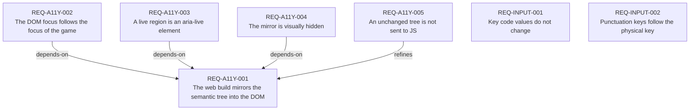

# Requirements index — `requirements`

<!-- GENERATED by requirements/check.mjs — do not edit by hand. -->
<!-- Regenerate with `yarn requirements:build`. -->

| ID | Title | Status | Type | Priority | Source |
|---|---|---|---|---|---|
| [`REQ-A11Y-001`](a11y.md#req-a11y-001--the-web-build-mirrors-the-semantic-tree-into-the-dom) | The web build mirrors the semantic tree into the DOM | active | functional | P1 | sean |
| [`REQ-A11Y-002`](a11y.md#req-a11y-002--the-dom-focus-follows-the-focus-of-the-game) | The DOM focus follows the focus of the game | active | functional | P1 | sean |
| [`REQ-A11Y-003`](a11y.md#req-a11y-003--a-live-region-is-an-aria-live-element) | A live region is an aria-live element | active | functional | P1 | sean |
| [`REQ-A11Y-004`](a11y.md#req-a11y-004--the-mirror-is-visually-hidden) | The mirror is visually hidden | active | constraint | P1 | sean |
| [`REQ-A11Y-005`](a11y.md#req-a11y-005--an-unchanged-tree-is-not-sent-to-js) | An unchanged tree is not sent to JS | active | quality | P1 | sean |
| [`REQ-INPUT-001`](input.md#req-input-001--key-code-values-do-not-change) | Key code values do not change | active | constraint | P2 | agent:SWZ-3 |
| [`REQ-INPUT-002`](input.md#req-input-002--punctuation-keys-follow-the-physical-key) | Punctuation keys follow the physical key | active | functional | P2 | agent:SWZ-3 |

## Dependency graph

## Derived reverse links

- `REQ-A11Y-001` — required-by REQ-A11Y-002, required-by REQ-A11Y-003, required-by REQ-A11Y-004, refined-by REQ-A11Y-005
