# Requirements index — `requirements`

<!-- GENERATED by requirements/check.mjs — do not edit by hand. -->
<!-- Regenerate with `yarn requirements:build`. -->

| ID | Title | Status | Type | Priority | Source |
|---|---|---|---|---|---|
| [`REQ-A11Y-001`](a11y.md#req-a11y-001--the-web-build-mirrors-the-semantic-tree-into-the-dom) | The web build mirrors the semantic tree into the DOM | active | functional | P1 | sean |
| [`REQ-A11Y-002`](a11y.md#req-a11y-002--the-dom-focus-follows-the-focus-of-the-game) | The DOM focus follows the focus of the game | active | functional | P1 | sean |
| [`REQ-A11Y-003`](a11y.md#req-a11y-003--a-live-region-is-an-aria-live-element) | A live region is an aria-live element | active | functional | P1 | sean |
| [`REQ-A11Y-004`](a11y.md#req-a11y-004--the-mirror-is-visually-hidden) | The mirror is visually hidden | active | constraint | P1 | sean |
| [`REQ-A11Y-005`](a11y.md#req-a11y-005--an-unchanged-tree-is-not-sent-to-js) | An unchanged tree is not sent to JS | active | quality | P1 | sean |
| [`REQ-A11Y-006`](a11y.md#req-a11y-006--each-widget-has-its-aria-role-in-the-mirror) | Each widget has its ARIA role in the mirror | active | functional | P2 | agent:SWZ-47 |
| [`REQ-ASSETS-001`](assets.md#req-assets-001--opening-a-zip-archive-does-not-decompress-it) | Opening a zip archive does not decompress it | active | quality | P1 | agent:SWZ-54 |
| [`REQ-ASSETS-002`](assets.md#req-assets-002--the-cache-tells-why-opfs-is-missing) | The cache tells why OPFS is missing | active | functional | P2 | agent:SWZ-54 |
| [`REQ-AUDIO-001`](audio.md#req-audio-001--the-waveform-api-does-not-change) | The waveform API does not change | active | constraint | P1 | agent:SWZ-48 |
| [`REQ-AUDIO-002`](audio.md#req-audio-002--a-stream-does-not-decode-all-of-its-data) | A stream does not decode all of its data | active | quality | P1 | agent:SWZ-48 |
| [`REQ-CAMERA-001`](camera.md#req-camera-001--the-camera-result-does-not-depend-on-the-frame-rate) | The camera result does not depend on the frame rate | active | quality | P2 | agent:SWZ-43 |
| [`REQ-CAMERA-002`](camera.md#req-camera-002--the-camera-controller-reads-no-platform-input) | The camera controller reads no platform input | active | constraint | P2 | agent:SWZ-43 |
| [`REQ-GPU-001`](gpu.md#req-gpu-001--the-gpu-makes-the-mip-levels-on-native-and-on-the-web) | The GPU makes the mip levels on native and on the web | active | functional | P1 | agent:SWZ-27 |
| [`REQ-GPU-002`](gpu.md#req-gpu-002--the-mip-levels-of-an-atlas-do-not-mix-tiles) | The mip levels of an atlas do not mix tiles | active | constraint | P1 | agent:SWZ-27 |
| [`REQ-GPU-003`](gpu.md#req-gpu-003--an-animated-sprite-changes-with-gpu-copies-only) | An animated sprite changes with GPU copies only | active | functional | P1 | agent:SWZ-28 |
| [`REQ-GPU-004`](gpu.md#req-gpu-004--the-atlas-packer-keeps-each-image-on-the-cell-grid) | The atlas packer keeps each image on the cell grid | active | constraint | P1 | agent:SWZ-28 |
| [`REQ-GPU-005`](gpu.md#req-gpu-005--the-frame-graph-runs-the-passes-in-a-set-order-on-targets-that-follow-the-window) | The frame graph runs the passes in a set order on targets that follow the window | active | functional | P1 | agent:SWZ-29 |
| [`REQ-GPU-006`](gpu.md#req-gpu-006--per-frame-data-uses-no-new-gpu-buffer-each-frame) | Per-frame data uses no new GPU buffer each frame | active | constraint | P1 | agent:SWZ-29 |
| [`REQ-GPU-007`](gpu.md#req-gpu-007--the-wgsl-prefix-matches-the-frame-uniforms) | The WGSL prefix matches the frame uniforms | active | constraint | P1 | agent:SWZ-29 |
| [`REQ-GPU-008`](gpu.md#req-gpu-008--the-scene-renders-to-an-hdr-target-and-a-tonemap-writes-display-colour) | The scene renders to an HDR target, and a tonemap writes display colour | active | functional | P2 | agent:SWZ-30 |
| [`REQ-GPU-009`](gpu.md#req-gpu-009--the-post-chain-runs-its-passes-in-order-and-fxaa-is-one-link) | The post chain runs its passes in order, and FXAA is one link | active | functional | P2 | agent:SWZ-30 |
| [`REQ-GPU-010`](gpu.md#req-gpu-010--the-sky-pass-draws-the-sky-from-a-time-of-day) | The sky pass draws the sky from a time of day | active | functional | P2 | agent:SWZ-36 |
| [`REQ-GPU-011`](gpu.md#req-gpu-011--the-distance-fog-fades-into-the-sky-colour-at-the-horizon) | The distance fog fades into the sky colour at the horizon | active | functional | P2 | agent:SWZ-36 |
| [`REQ-GPU-012`](gpu.md#req-gpu-012--the-web-bridge-keeps-no-surface-view-or-command-object-from-an-earlier-frame) | The web bridge keeps no surface view or command object from an earlier frame | active | functional | P1 | agent:SWZ-68 |
| [`REQ-GPU-013`](gpu.md#req-gpu-013--the-web-canvas-has-the-screen-format-of-the-zig-side) | The web canvas has the screen format of the Zig side | active | functional | P1 | agent:SWZ-68 |
| [`REQ-GPU-014`](gpu.md#req-gpu-014--one-draw-call-draws-all-instances-of-one-box-model) | One draw call draws all instances of one box model | active | functional | P2 | agent:SWZ-41 |
| [`REQ-GPU-015`](gpu.md#req-gpu-015--the-first-person-pass-draws-in-front-of-the-world) | The first-person pass draws in front of the world | active | functional | P2 | agent:SWZ-41 |
| [`REQ-GPU-016`](gpu.md#req-gpu-016--a-cascaded-shadow-map-shadows-the-scene-from-one-directional-light) | A cascaded shadow map shadows the scene from one directional light | active | functional | P2 | agent:SWZ-38 |
| [`REQ-GPU-017`](gpu.md#req-gpu-017--the-lit-passes-add-the-point-lights-of-the-frame) | The lit passes add the point lights of the frame | active | functional | P2 | agent:SWZ-38 |
| [`REQ-GPU-018`](gpu.md#req-gpu-018--a-setting-turns-the-shadows-off) | A setting turns the shadows off | active | functional | P2 | agent:SWZ-38 |
| [`REQ-GPU-020`](gpu.md#req-gpu-020--the-cloud-layer-moves-with-the-wind-and-takes-its-shape-from-the-game) | The cloud layer moves with the wind and takes its shape from the game | active | functional | P3 | agent:SWZ-37 |
| [`REQ-GPU-021`](gpu.md#req-gpu-021--rain-and-snow-fall-around-the-camera-and-stop-at-the-height-map) | Rain and snow fall around the camera and stop at the height map | active | functional | P3 | agent:SWZ-37 |
| [`REQ-GPU-022`](gpu.md#req-gpu-022--translucent-quads-draw-after-the-opaque-scene-with-no-depth-write) | Translucent quads draw after the opaque scene with no depth write | active | functional | P2 | agent:SWZ-35 |
| [`REQ-GPU-023`](gpu.md#req-gpu-023--the-translucent-pass-sorts-its-quads-from-far-to-near) | The translucent pass sorts its quads from far to near | active | functional | P2 | agent:SWZ-35 |
| [`REQ-GPU-024`](gpu.md#req-gpu-024--particles-draw-as-camera-facing-quads-in-one-draw-call-far-to-near) | Particles draw as camera-facing quads in one draw call, far to near | active | functional | P3 | agent:SWZ-42 |
| [`REQ-GPU-025`](gpu.md#req-gpu-025--a-full-particle-system-drops-its-oldest-particle) | A full particle system drops its oldest particle | active | functional | P3 | agent:SWZ-42 |
| [`REQ-GPU-026`](gpu.md#req-gpu-026--a-preset-sets-each-graphics-setting) | A preset sets each graphics setting | active | functional | P3 | agent:SWZ-44 |
| [`REQ-GPU-027`](gpu.md#req-gpu-027--the-frame-limiter-holds-a-target-frame-rate) | The frame limiter holds a target frame rate | active | functional | P3 | agent:SWZ-44 |
| [`REQ-GPU-028`](gpu.md#req-gpu-028--gpu-timestamps-time-each-render-pass) | GPU timestamps time each render pass | active | functional | P3 | agent:SWZ-44 |
| [`REQ-GPU-029`](gpu.md#req-gpu-029--the-overlay-draws-a-frame-time-chart-with-sw_gfx2d) | The overlay draws a frame-time chart with sw_gfx2d | active | functional | P3 | agent:SWZ-44 |
| [`REQ-GPU-030`](gpu.md#req-gpu-030--a-post-effect-reads-the-depth-target-and-gives-the-fog) | A post effect reads the depth target and gives the fog | active | functional | P3 | agent:SWZ-81 |
| [`REQ-GPU-031`](gpu.md#req-gpu-031--a-cloud-puts-a-moving-shadow-on-the-ground-under-it) | A cloud puts a moving shadow on the ground under it | active | functional | P2 | agent:SWZ-101 |
| [`REQ-GPU-032`](gpu.md#req-gpu-032--soft-clouds-have-semi-transparent-edges-and-a-rim-toward-the-sun) | Soft clouds have semi-transparent edges and a rim toward the sun | active | functional | P2 | agent:SWZ-101 |
| [`REQ-GPU-033`](gpu.md#req-gpu-033--light-shafts-go-toward-the-sun-on-the-screen) | Light shafts go toward the sun on the screen | active | functional | P2 | agent:SWZ-101 |
| [`REQ-INPUT-001`](input.md#req-input-001--key-code-values-do-not-change) | Key code values do not change | active | constraint | P2 | agent:SWZ-3 |
| [`REQ-INPUT-002`](input.md#req-input-002--punctuation-keys-follow-the-physical-key) | Punctuation keys follow the physical key | active | functional | P2 | agent:SWZ-3 |
| [`REQ-INPUT-003`](input.md#req-input-003--actions-come-only-from-the-input-and-the-bindings) | Actions come only from the input and the bindings | active | constraint | P1 | agent:SWZ-49 |
| [`REQ-INPUT-004`](input.md#req-input-004--saved-input-settings-load-in-a-newer-version) | Saved input settings load in a newer version | active | functional | P2 | agent:SWZ-49 |
| [`REQ-INPUT-005`](input.md#req-input-005--gamepads-are-recorded-input-that-binds-to-actions) | Gamepads are recorded input that binds to actions | active | functional | P2 | agent:SWZ-50 |
| [`REQ-INPUT-006`](input.md#req-input-006--old-recordings-still-play) | Old recordings still play | active | constraint | P1 | agent:SWZ-50 |
| [`REQ-INPUT-007`](input.md#req-input-007--a-key-press-shorter-than-one-tick-is-not-lost) | A key press shorter than one tick is not lost | active | functional | P2 | agent:SWZ-92 |
| [`REQ-NET-001`](net.md#req-net-001--the-game-polls-network-events) | The game polls network events | active | constraint | P1 | agent:SWZ-53 |
| [`REQ-NET-002`](net.md#req-net-002--the-native-client-masks-each-frame) | The native client masks each frame | active | functional | P1 | agent:SWZ-53 |
| [`REQ-NET-003`](net.md#req-net-003--the-reconnect-delay-doubles-to-a-limit) | The reconnect delay doubles to a limit | active | functional | P2 | agent:SWZ-53 |
| [`REQ-PLATFORM-001`](platform.md#req-platform-001--a-refused-pointer-lock-does-not-stop-the-game) | A refused pointer lock does not stop the game | active | functional | P2 | agent:SWZ-45 |
| [`REQ-PLATFORM-002`](platform.md#req-platform-002--clipboard-results-arrive-as-events) | Clipboard results arrive as events | active | functional | P2 | agent:SWZ-45 |
| [`REQ-PLATFORM-003`](platform.md#req-platform-003--the-canvas-and-the-surface-follow-the-device-pixel-ratio) | The canvas and the surface follow the device pixel ratio | active | functional | P2 | agent:SWZ-45 |
| [`REQ-TEXT-001`](text.md#req-text-001--arabic-letters-take-their-joined-forms-before-reordering) | Arabic letters take their joined forms before reordering | active | functional | P3 | sean |
| [`REQ-TEXT-002`](text.md#req-text-002--lam-followed-by-alef-is-one-ligature) | Lam followed by alef is one ligature | active | functional | P3 | sean |
| [`REQ-TEXT-003`](text.md#req-text-003--measuring-uses-the-shaped-text) | Measuring uses the shaped text | active | functional | P3 | sean |
| [`REQ-TEXT-004`](text.md#req-text-004--a-missing-presentation-form-draws-as-its-letter) | A missing presentation form draws as its letter | active | functional | P3 | agent:SWZ-63 |
| [`REQ-TEXT-005`](text.md#req-text-005--the-caret-maps-back-to-the-text-in-shaped-text) | The caret maps back to the text in shaped text | active | functional | P3 | sean |
| [`REQ-TEXT-006`](text.md#req-text-006--diacritics-do-not-break-a-join) | Diacritics do not break a join | active | functional | P3 | sean |
| [`REQ-TEXT-007`](text.md#req-text-007--text-with-no-arabic-letters-is-unchanged) | Text with no Arabic letters is unchanged | active | constraint | P3 | sean |
| [`REQ-VOXEL-001`](voxel.md#req-voxel-001--a-block-with-a-baked-model-gets-the-model-mesher) | A block with a baked model gets the model mesher | active | functional | P1 | agent:SWZ-31 |
| [`REQ-VOXEL-002`](voxel.md#req-voxel-002--a-full-cube-hides-a-model-quad-with-a-cull-face) | A full cube hides a model quad with a cull face | active | functional | P1 | agent:SWZ-31 |
| [`REQ-VOXEL-003`](voxel.md#req-voxel-003--the-content-gives-the-opacity-and-the-emission-of-each-block) | The content gives the opacity and the emission of each block | active | functional | P1 | agent:SWZ-32 |
| [`REQ-VOXEL-004`](voxel.md#req-voxel-004--sky-light-falls-straight-down-without-loss) | Sky light falls straight down without loss | active | functional | P1 | agent:SWZ-32 |
| [`REQ-VOXEL-005`](voxel.md#req-voxel-005--an-edit-updates-the-light-incrementally) | An edit updates the light incrementally | active | quality | P1 | agent:SWZ-32 |
| [`REQ-VOXEL-006`](voxel.md#req-voxel-006--a-moving-box-stops-at-the-collision-boxes-of-the-blocks) | A moving box stops at the collision boxes of the blocks | active | functional | P2 | agent:SWZ-51 |
| [`REQ-VOXEL-007`](voxel.md#req-voxel-007--a-voxel-ray-cast-gives-the-first-block-its-face-and-the-distance) | A voxel ray cast gives the first block, its face and the distance | active | functional | P2 | agent:SWZ-51 |
| [`REQ-VOXEL-008`](voxel.md#req-voxel-008--each-corner-gets-ao-and-smooth-light) | Each corner gets AO and smooth light | active | functional | P2 | agent:SWZ-33 |
| [`REQ-VOXEL-009`](voxel.md#req-voxel-009--the-content-gives-the-tint-colours) | The content gives the tint colours | active | functional | P2 | agent:SWZ-33 |
| [`REQ-VOXEL-010`](voxel.md#req-voxel-010--greedy-meshing-merges-only-equal-faces) | Greedy meshing merges only equal faces | active | functional | P2 | agent:SWZ-33 |
| [`REQ-VOXEL-011`](voxel.md#req-voxel-011--a-saved-region-gives-the-same-blocks-when-it-loads) | A saved region gives the same blocks when it loads | active | functional | P2 | agent:SWZ-52 |
| [`REQ-VOXEL-012`](voxel.md#req-voxel-012--a-later-format-reads-the-region-files-of-version-1) | A later format reads the region files of version 1 | active | constraint | P2 | agent:SWZ-52 |
| [`REQ-VOXEL-013`](voxel.md#req-voxel-013--a-damaged-chunk-in-a-region-file-fails-alone) | A damaged chunk in a region file fails alone | active | functional | P2 | agent:SWZ-52 |
| [`REQ-VOXEL-014`](voxel.md#req-voxel-014--a-fluid-surface-has-a-height-at-each-corner) | A fluid surface has a height at each corner | active | functional | P2 | agent:SWZ-34 |
| [`REQ-VOXEL-015`](voxel.md#req-voxel-015--two-cells-of-one-fluid-have-no-face-between-them) | Two cells of one fluid have no face between them | active | functional | P2 | agent:SWZ-34 |
| [`REQ-VOXEL-016`](voxel.md#req-voxel-016--the-texture-of-a-fluid-surface-follows-the-flow) | The texture of a fluid surface follows the flow | active | functional | P3 | agent:SWZ-34 |
| [`REQ-VOXEL-017`](voxel.md#req-voxel-017--the-mesh-uploads-of-one-frame-have-a-limit-and-a-priority) | The mesh uploads of one frame have a limit and a priority | active | quality | P2 | agent:SWZ-55 |
| [`REQ-VOXEL-018`](voxel.md#req-voxel-018--a-fast-player-has-no-long-hole-near-the-player) | A fast player has no long hole near the player | active | quality | P2 | agent:SWZ-55 |

## Dependency graph

```mermaid
graph TD
  REQ_A11Y_001["REQ-A11Y-001<br/>The web build mirrors the semantic tree into the DOM"]
  REQ_A11Y_002["REQ-A11Y-002<br/>The DOM focus follows the focus of the game"]
  REQ_A11Y_003["REQ-A11Y-003<br/>A live region is an aria-live element"]
  REQ_A11Y_004["REQ-A11Y-004<br/>The mirror is visually hidden"]
  REQ_A11Y_005["REQ-A11Y-005<br/>An unchanged tree is not sent to JS"]
  REQ_A11Y_006["REQ-A11Y-006<br/>Each widget has its ARIA role in the mirror"]
  REQ_ASSETS_001["REQ-ASSETS-001<br/>Opening a zip archive does not decompress it"]
  REQ_ASSETS_002["REQ-ASSETS-002<br/>The cache tells why OPFS is missing"]
  REQ_AUDIO_001["REQ-AUDIO-001<br/>The waveform API does not change"]
  REQ_AUDIO_002["REQ-AUDIO-002<br/>A stream does not decode all of its data"]
  REQ_CAMERA_001["REQ-CAMERA-001<br/>The camera result does not depend on the frame rate"]
  REQ_CAMERA_002["REQ-CAMERA-002<br/>The camera controller reads no platform input"]
  REQ_GPU_001["REQ-GPU-001<br/>The GPU makes the mip levels on native and on the web"]
  REQ_GPU_002["REQ-GPU-002<br/>The mip levels of an atlas do not mix tiles"]
  REQ_GPU_003["REQ-GPU-003<br/>An animated sprite changes with GPU copies only"]
  REQ_GPU_004["REQ-GPU-004<br/>The atlas packer keeps each image on the cell grid"]
  REQ_GPU_005["REQ-GPU-005<br/>The frame graph runs the passes in a set order on targets that follow the window"]
  REQ_GPU_006["REQ-GPU-006<br/>Per-frame data uses no new GPU buffer each frame"]
  REQ_GPU_007["REQ-GPU-007<br/>The WGSL prefix matches the frame uniforms"]
  REQ_GPU_008["REQ-GPU-008<br/>The scene renders to an HDR target, and a tonemap writes display colour"]
  REQ_GPU_009["REQ-GPU-009<br/>The post chain runs its passes in order, and FXAA is one link"]
  REQ_GPU_010["REQ-GPU-010<br/>The sky pass draws the sky from a time of day"]
  REQ_GPU_011["REQ-GPU-011<br/>The distance fog fades into the sky colour at the horizon"]
  REQ_GPU_012["REQ-GPU-012<br/>The web bridge keeps no surface view or command object from an earlier frame"]
  REQ_GPU_013["REQ-GPU-013<br/>The web canvas has the screen format of the Zig side"]
  REQ_GPU_014["REQ-GPU-014<br/>One draw call draws all instances of one box model"]
  REQ_GPU_015["REQ-GPU-015<br/>The first-person pass draws in front of the world"]
  REQ_GPU_016["REQ-GPU-016<br/>A cascaded shadow map shadows the scene from one directional light"]
  REQ_GPU_017["REQ-GPU-017<br/>The lit passes add the point lights of the frame"]
  REQ_GPU_018["REQ-GPU-018<br/>A setting turns the shadows off"]
  REQ_GPU_020["REQ-GPU-020<br/>The cloud layer moves with the wind and takes its shape from the game"]
  REQ_GPU_021["REQ-GPU-021<br/>Rain and snow fall around the camera and stop at the height map"]
  REQ_GPU_022["REQ-GPU-022<br/>Translucent quads draw after the opaque scene with no depth write"]
  REQ_GPU_023["REQ-GPU-023<br/>The translucent pass sorts its quads from far to near"]
  REQ_GPU_024["REQ-GPU-024<br/>Particles draw as camera-facing quads in one draw call, far to near"]
  REQ_GPU_025["REQ-GPU-025<br/>A full particle system drops its oldest particle"]
  REQ_GPU_026["REQ-GPU-026<br/>A preset sets each graphics setting"]
  REQ_GPU_027["REQ-GPU-027<br/>The frame limiter holds a target frame rate"]
  REQ_GPU_028["REQ-GPU-028<br/>GPU timestamps time each render pass"]
  REQ_GPU_029["REQ-GPU-029<br/>The overlay draws a frame-time chart with sw_gfx2d"]
  REQ_GPU_030["REQ-GPU-030<br/>A post effect reads the depth target and gives the fog"]
  REQ_GPU_031["REQ-GPU-031<br/>A cloud puts a moving shadow on the ground under it"]
  REQ_GPU_032["REQ-GPU-032<br/>Soft clouds have semi-transparent edges and a rim toward the sun"]
  REQ_GPU_033["REQ-GPU-033<br/>Light shafts go toward the sun on the screen"]
  REQ_INPUT_001["REQ-INPUT-001<br/>Key code values do not change"]
  REQ_INPUT_002["REQ-INPUT-002<br/>Punctuation keys follow the physical key"]
  REQ_INPUT_003["REQ-INPUT-003<br/>Actions come only from the input and the bindings"]
  REQ_INPUT_004["REQ-INPUT-004<br/>Saved input settings load in a newer version"]
  REQ_INPUT_005["REQ-INPUT-005<br/>Gamepads are recorded input that binds to actions"]
  REQ_INPUT_006["REQ-INPUT-006<br/>Old recordings still play"]
  REQ_INPUT_007["REQ-INPUT-007<br/>A key press shorter than one tick is not lost"]
  REQ_NET_001["REQ-NET-001<br/>The game polls network events"]
  REQ_NET_002["REQ-NET-002<br/>The native client masks each frame"]
  REQ_NET_003["REQ-NET-003<br/>The reconnect delay doubles to a limit"]
  REQ_PLATFORM_001["REQ-PLATFORM-001<br/>A refused pointer lock does not stop the game"]
  REQ_PLATFORM_002["REQ-PLATFORM-002<br/>Clipboard results arrive as events"]
  REQ_PLATFORM_003["REQ-PLATFORM-003<br/>The canvas and the surface follow the device pixel ratio"]
  REQ_TEXT_001["REQ-TEXT-001<br/>Arabic letters take their joined forms before reordering"]
  REQ_TEXT_002["REQ-TEXT-002<br/>Lam followed by alef is one ligature"]
  REQ_TEXT_003["REQ-TEXT-003<br/>Measuring uses the shaped text"]
  REQ_TEXT_004["REQ-TEXT-004<br/>A missing presentation form draws as its letter"]
  REQ_TEXT_005["REQ-TEXT-005<br/>The caret maps back to the text in shaped text"]
  REQ_TEXT_006["REQ-TEXT-006<br/>Diacritics do not break a join"]
  REQ_TEXT_007["REQ-TEXT-007<br/>Text with no Arabic letters is unchanged"]
  REQ_VOXEL_001["REQ-VOXEL-001<br/>A block with a baked model gets the model mesher"]
  REQ_VOXEL_002["REQ-VOXEL-002<br/>A full cube hides a model quad with a cull face"]
  REQ_VOXEL_003["REQ-VOXEL-003<br/>The content gives the opacity and the emission of each block"]
  REQ_VOXEL_004["REQ-VOXEL-004<br/>Sky light falls straight down without loss"]
  REQ_VOXEL_005["REQ-VOXEL-005<br/>An edit updates the light incrementally"]
  REQ_VOXEL_006["REQ-VOXEL-006<br/>A moving box stops at the collision boxes of the blocks"]
  REQ_VOXEL_007["REQ-VOXEL-007<br/>A voxel ray cast gives the first block, its face and the distance"]
  REQ_VOXEL_008["REQ-VOXEL-008<br/>Each corner gets AO and smooth light"]
  REQ_VOXEL_009["REQ-VOXEL-009<br/>The content gives the tint colours"]
  REQ_VOXEL_010["REQ-VOXEL-010<br/>Greedy meshing merges only equal faces"]
  REQ_VOXEL_011["REQ-VOXEL-011<br/>A saved region gives the same blocks when it loads"]
  REQ_VOXEL_012["REQ-VOXEL-012<br/>A later format reads the region files of version 1"]
  REQ_VOXEL_013["REQ-VOXEL-013<br/>A damaged chunk in a region file fails alone"]
  REQ_VOXEL_014["REQ-VOXEL-014<br/>A fluid surface has a height at each corner"]
  REQ_VOXEL_015["REQ-VOXEL-015<br/>Two cells of one fluid have no face between them"]
  REQ_VOXEL_016["REQ-VOXEL-016<br/>The texture of a fluid surface follows the flow"]
  REQ_VOXEL_017["REQ-VOXEL-017<br/>The mesh uploads of one frame have a limit and a priority"]
  REQ_VOXEL_018["REQ-VOXEL-018<br/>A fast player has no long hole near the player"]
  REQ_A11Y_002 -->|depends-on| REQ_A11Y_001
  REQ_A11Y_003 -->|depends-on| REQ_A11Y_001
  REQ_A11Y_004 -->|depends-on| REQ_A11Y_001
  REQ_A11Y_005 -->|refines| REQ_A11Y_001
  REQ_A11Y_006 -->|refines| REQ_A11Y_001
  REQ_GPU_002 -->|refines| REQ_GPU_001
  REQ_GPU_004 -->|refines| REQ_GPU_002
  REQ_GPU_008 -->|refines| REQ_GPU_005
  REQ_GPU_009 -->|refines| REQ_GPU_005
  REQ_GPU_010 -->|refines| REQ_GPU_008
  REQ_GPU_011 -->|refines| REQ_GPU_010
  REQ_GPU_012 -->|refines| REQ_GPU_005
  REQ_GPU_013 -->|refines| REQ_GPU_005
  REQ_GPU_014 -->|refines| REQ_GPU_006
  REQ_GPU_015 -->|refines| REQ_GPU_014
  REQ_GPU_016 -->|refines| REQ_GPU_005
  REQ_GPU_016 -->|refines| REQ_GPU_014
  REQ_GPU_017 -->|refines| REQ_GPU_006
  REQ_GPU_018 -->|refines| REQ_GPU_016
  REQ_GPU_020 -->|refines| REQ_GPU_011
  REQ_GPU_021 -->|refines| REQ_GPU_011
  REQ_GPU_023 -->|depends-on| REQ_GPU_022
  REQ_GPU_024 -->|depends-on| REQ_GPU_022
  REQ_GPU_030 -->|depends-on| REQ_GPU_011
  REQ_GPU_031 -->|depends-on| REQ_GPU_020
  REQ_GPU_031 -->|depends-on| REQ_GPU_030
  REQ_GPU_032 -->|depends-on| REQ_GPU_020
  REQ_GPU_033 -->|depends-on| REQ_GPU_030
  REQ_TEXT_002 -->|refines| REQ_TEXT_001
  REQ_TEXT_003 -->|depends-on| REQ_TEXT_001
  REQ_TEXT_004 -->|refines| REQ_TEXT_001
  REQ_TEXT_005 -->|depends-on| REQ_TEXT_002
  REQ_TEXT_006 -->|refines| REQ_TEXT_001
  REQ_VOXEL_002 -->|refines| REQ_VOXEL_001
  REQ_VOXEL_004 -->|refines| REQ_VOXEL_003
  REQ_VOXEL_005 -->|depends-on| REQ_VOXEL_003
  REQ_VOXEL_007 -->|depends-on| REQ_VOXEL_006
  REQ_VOXEL_008 -->|depends-on| REQ_VOXEL_003
  REQ_VOXEL_009 -->|refines| REQ_VOXEL_001
  REQ_VOXEL_010 -->|refines| REQ_VOXEL_008
  REQ_VOXEL_010 -->|refines| REQ_VOXEL_009
  REQ_VOXEL_012 -->|depends-on| REQ_VOXEL_011
  REQ_VOXEL_013 -->|depends-on| REQ_VOXEL_011
  REQ_VOXEL_015 -->|refines| REQ_VOXEL_014
  REQ_VOXEL_016 -->|refines| REQ_VOXEL_014
```

## Derived reverse links

- `REQ-A11Y-001` — required-by REQ-A11Y-002, required-by REQ-A11Y-003, required-by REQ-A11Y-004, refined-by REQ-A11Y-005, refined-by REQ-A11Y-006
- `REQ-GPU-001` — refined-by REQ-GPU-002
- `REQ-GPU-002` — refined-by REQ-GPU-004
- `REQ-GPU-005` — refined-by REQ-GPU-008, refined-by REQ-GPU-009, refined-by REQ-GPU-012, refined-by REQ-GPU-013, refined-by REQ-GPU-016
- `REQ-GPU-006` — refined-by REQ-GPU-014, refined-by REQ-GPU-017
- `REQ-GPU-008` — refined-by REQ-GPU-010
- `REQ-GPU-010` — refined-by REQ-GPU-011
- `REQ-GPU-011` — refined-by REQ-GPU-020, refined-by REQ-GPU-021, required-by REQ-GPU-030
- `REQ-GPU-014` — refined-by REQ-GPU-015, refined-by REQ-GPU-016
- `REQ-GPU-016` — refined-by REQ-GPU-018
- `REQ-GPU-020` — required-by REQ-GPU-031, required-by REQ-GPU-032
- `REQ-GPU-022` — required-by REQ-GPU-023, required-by REQ-GPU-024
- `REQ-GPU-030` — required-by REQ-GPU-031, required-by REQ-GPU-033
- `REQ-TEXT-001` — refined-by REQ-TEXT-002, required-by REQ-TEXT-003, refined-by REQ-TEXT-004, refined-by REQ-TEXT-006
- `REQ-TEXT-002` — required-by REQ-TEXT-005
- `REQ-VOXEL-001` — refined-by REQ-VOXEL-002, refined-by REQ-VOXEL-009
- `REQ-VOXEL-003` — refined-by REQ-VOXEL-004, required-by REQ-VOXEL-005, required-by REQ-VOXEL-008
- `REQ-VOXEL-006` — required-by REQ-VOXEL-007
- `REQ-VOXEL-008` — refined-by REQ-VOXEL-010
- `REQ-VOXEL-009` — refined-by REQ-VOXEL-010
- `REQ-VOXEL-011` — required-by REQ-VOXEL-012, required-by REQ-VOXEL-013
- `REQ-VOXEL-014` — refined-by REQ-VOXEL-015, refined-by REQ-VOXEL-016
